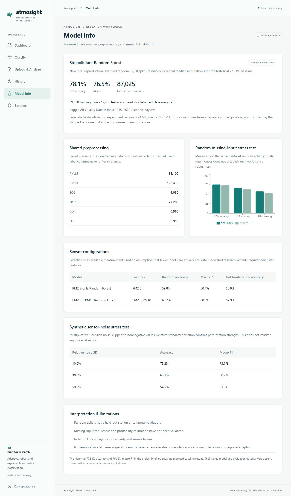
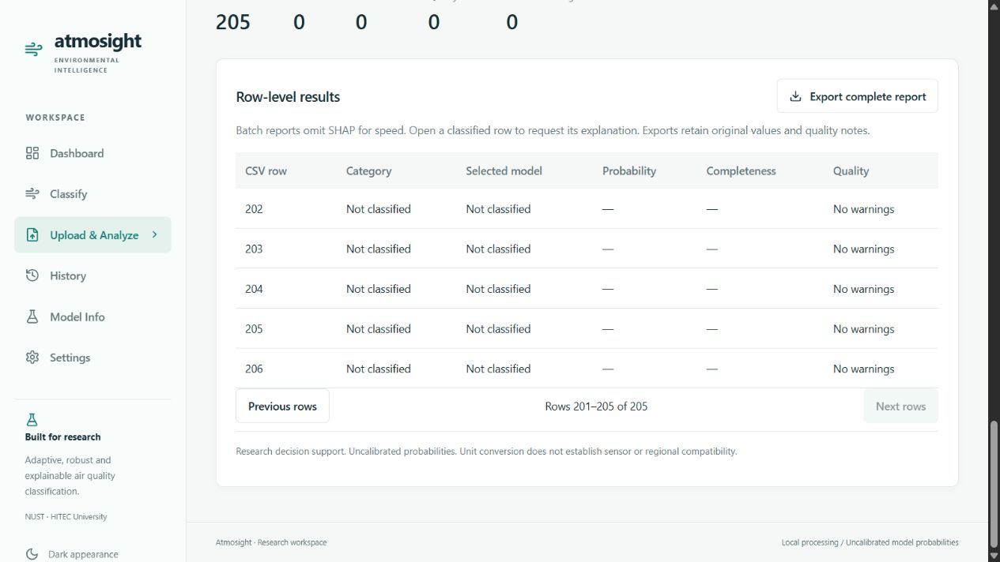
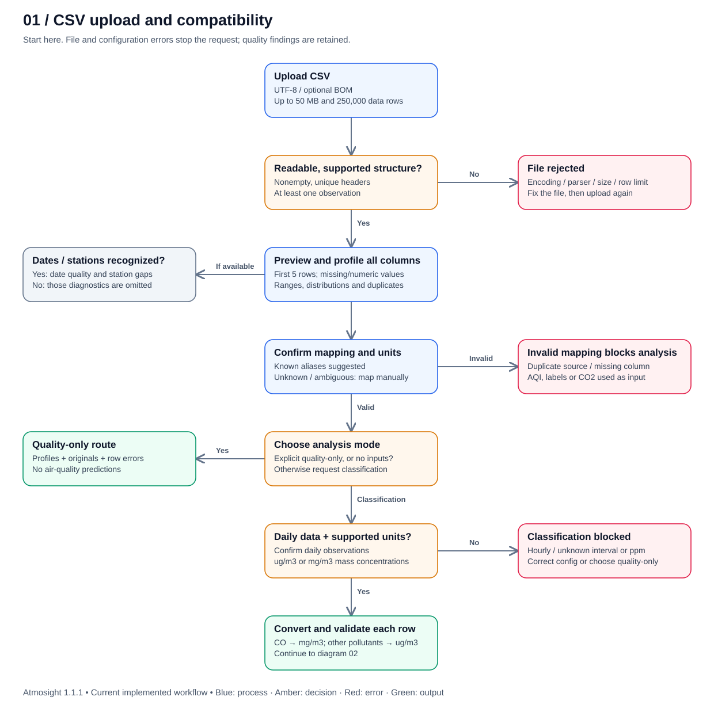
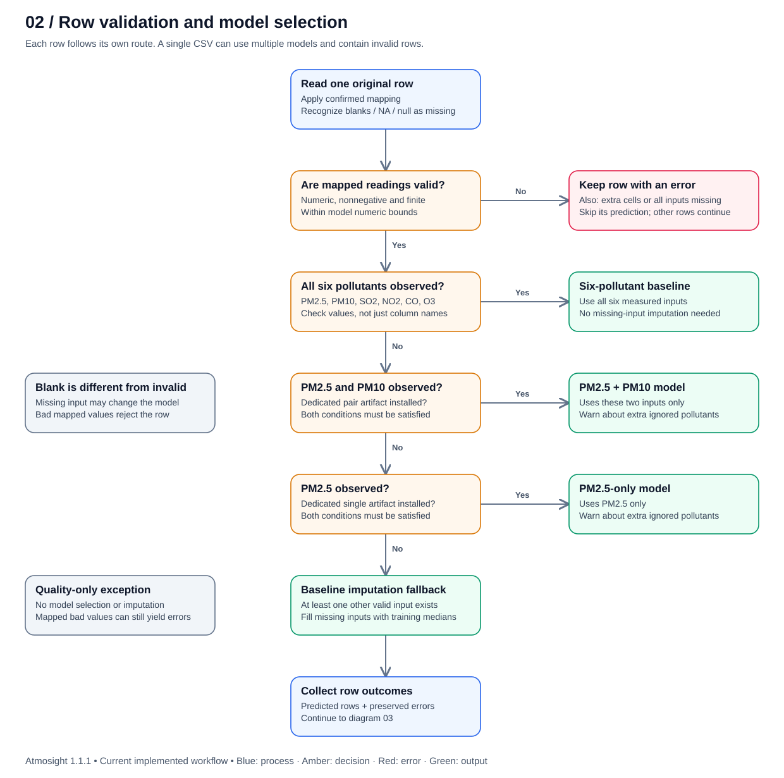
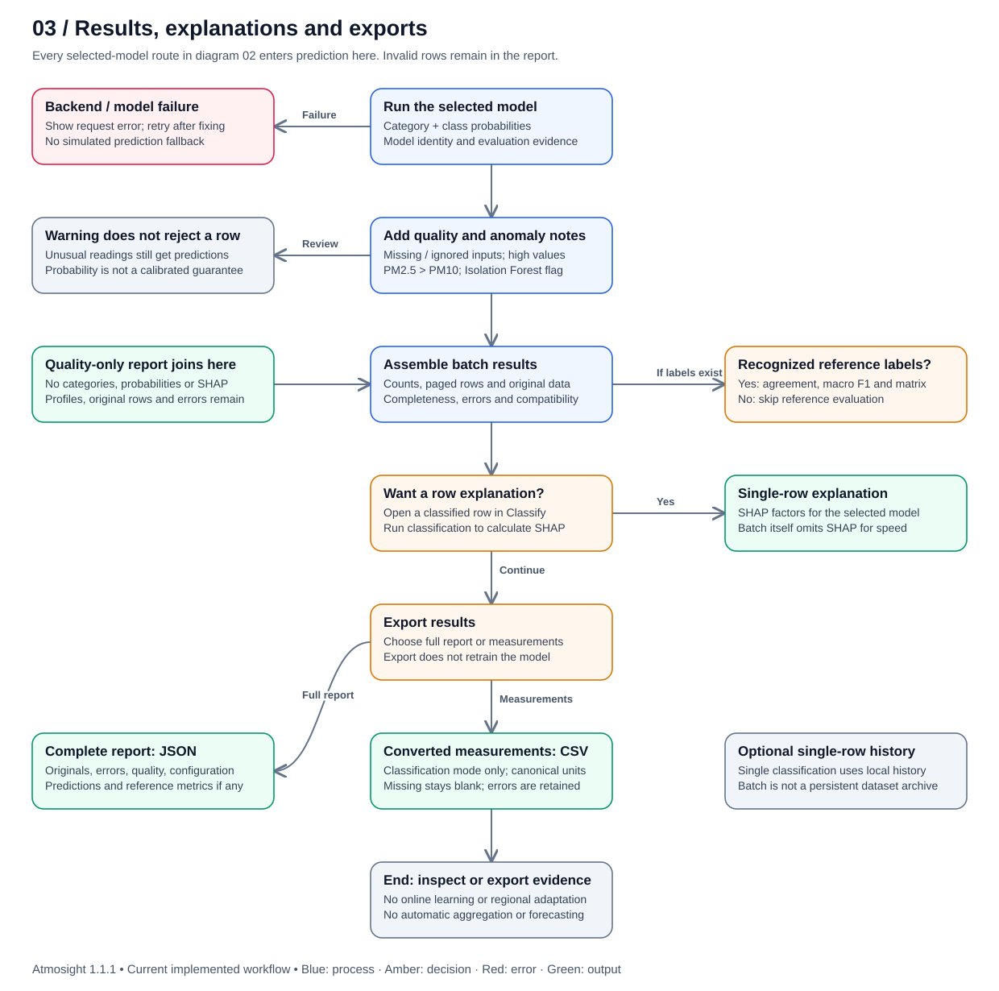

# Atmosight

Atmosight is a local desktop research application that estimates one of six air-quality categories—Good, Satisfactory, Moderate, Poor, Very Poor or Severe—from PM2.5, PM10, SO2, NO2, CO and O3 concentrations. It combines a Python FastAPI service, scikit-learn Random Forest models, SHAP explanations, a React/TypeScript interface and a Tauri 2 desktop shell.

## Screenshots




These are preserved screenshots of the real application. Some earlier screenshots in docs/screenshots show the previous baseline-only release; they are historical UI evidence, not screenshots captured during this cleanup.

## Features

- Classify a single reading, including partially observed inputs.
- Import CSV files, map columns, explicitly convert supported mass units, and inspect data-quality and station/date diagnostics.
- Select a model for each row from available inputs: six-pollutant baseline, PM2.5 + PM10, or PM2.5-only. Other combinations use the identified baseline imputation fallback.
- Explain single predictions with signed SHAP contributions to the predicted class probability. Batch processing omits SHAP; open a row in Classify for its explanation.
- Flag statistically unusual readings with Isolation Forest. An anomaly flag does not establish sensor failure.
- Export batch reports and local history, retaining original values and quality notes. Importing data does not retrain a model.

## Architecture

The React entry point is Design/src/main.tsx → App.tsx. Its engine service calls FastAPI on 127.0.0.1:8000. The backend validates observations, selects a compatible saved model, imputes missing inputs using training medians, then evaluates class probability, anomaly status and—on individual requests—SHAP. Tauri starts and owns the packaged Python sidecar.

The three CSV pipeline diagrams are available together in [the offline diagram viewer](diagrams/index.html), with editable Mermaid sources alongside each SVG:





## Repository layout

| Path | Purpose |
| --- | --- |
| backend/ | API, validation, training, evaluation, tests and small historical evaluation records |
| Dataset/ | Unchanged station_day.csv, its hash and CC0 source attribution |
| Design/ | React source, npm lockfile and Tauri source/icons/configuration |
| experiments/robustness/ | Study code/protocol, tests and immutable original results/ |
| docs/ | Technical reports and real app screenshots |
| diagrams/ | Three pipeline diagrams, Mermaid sources and local viewer |
| scripts/ | Setup, rebuilding, run tasks and integrity checks |
| PLAN.md / MANIFEST.md | Inspection decisions, inclusions, exclusions and modifications |
| VERIFICATION.md / COMMANDS.md | Actual checks, command outcomes and remaining limits |

Tests retain their original module locations; there was no top-level tests/ directory. Neither requested final Word/PDF report name was found, so docs/reports/ is absent.

## Requirements

Verified environment: Windows, Python 3.12.14, Node 24.21.0 and npm 11.19.0. Python 3.12 and a Node installation providing npm.cmd must be on PATH. The supplied PowerShell tasks target Windows. Direct Python dependencies are pinned in requirements.txt; requirements-lock.txt records the complete fresh installed environment. Research versions remain numpy 2.2.6, pandas 2.2.3, scipy 1.15.3 and scikit-learn 1.6.1.

Desktop builds additionally require Rust/MSVC, Microsoft C++ Build Tools with a Windows SDK, and WebView2. Model rebuilding requires CPU time, memory and disk space: the baseline alone is about 117 MB and is deliberately absent from Git.

## Install

Run commands from the repository root. No global PowerShell execution-policy change is needed.

```powershell
powershell -NoProfile -ExecutionPolicy Bypass -File scripts/tasks.ps1 setup
```

This creates backend/.venv, installs pinned direct Python dependencies and installs frontend dependencies from package-lock.json. If Python resolves to a non-working Windows Store alias, install Python 3.12 and fix PATH first. The validation used an explicit Python 3.12 runtime on PATH; no virtual environment was copied from the original project.

## Rebuild models

```powershell
powershell -NoProfile -ExecutionPolicy Bypass -File scripts/tasks.ps1 rebuild
```

The task verifies the dataset hash, trains the baseline, evaluates synthetic noise, trains both sensor variants and evaluates station transfer. It runs the existing training code unchanged. It generates ignored joblib files and refreshes backend/artifacts JSON records, including timestamps. The committed JSON files are preserved original evidence; rebuilding will legitimately make those records locally modified. Experiments keep their separate original result files.

## Run the backend

```powershell
powershell -NoProfile -ExecutionPolicy Bypass -File scripts/tasks.ps1 backend
```

The default endpoint is http://127.0.0.1:8000; GET /health checks service readiness and POST /predict classifies a reading. The cleanup smoke test used an isolated port through ATMOSIGHT_PORT and called both endpoints. Stop a development backend before starting the desktop app, which owns its own backend on port 8000.

## Run the app

For the browser interface, keep the backend running and start Vite in a second terminal:

```powershell
npm.cmd --prefix Design run dev
```

Open http://127.0.0.1:5173. This default development origin is allowed by the backend CORS configuration. To produce frontend assets:

```powershell
powershell -NoProfile -ExecutionPolicy Bypass -File scripts/tasks.ps1 build
```

For a native release, rebuild models first, then build the Python sidecar and Tauri executable:

```powershell
powershell -NoProfile -ExecutionPolicy Bypass -File scripts/build-backend.ps1
npm.cmd --prefix Design run tauri -- build --no-bundle
```

The native release build passed during cleanup. It creates Design/src-tauri/target/release/atmosight.exe alongside its sidecar. Keep that release directory together. scripts/tasks.ps1 also accepts the desktop task, which first freezes the Python sidecar and then launches Tauri development mode. scripts/build-adaptive-desktop.ps1 builds a separate portable executable. Generated binaries and build directories are excluded. NSIS installer creation/installation and native visual interaction remain UNVERIFIED; the frozen backend integration test passed. Consult VERIFICATION.md for the exact outcomes.

## CSV format and limits

Use UTF-8 (optional BOM), up to 50 MB (50,000,000 bytes) and 250,000 data rows. The application expects daily observations for classification; it does not aggregate hourly readings. Canonical pollutant headers are PM2.5, PM10, SO2, NO2, CO and O3; the import wizard supports aliases and explicit mapping. Baseline units are ug/m3 for all pollutants except CO, which uses mg/m3. Explicit ug/m3 ↔ mg/m3 conversion is supported. Unit conversion does not establish sensor compatibility; ppm conversion is unsupported.

```csv
PM2.5,PM10,SO2,NO2,CO,O3
42,80,12,20,0.8,35
42,,,,,
```

Blank/NA/null values can represent missing readings; negative, nonfinite or entirely missing prediction inputs are rejected. Invalid CSV rows remain visible in the report. Extra columns are preserved, and AQI/AQI_Bucket are reference labels, never prediction features. Processing uses 1,000-row chunks and displays 100 rows per page; exports include every row. Files and full reports remain in memory, so the limits do not imply unlimited streaming.

## Run tests and integrity checks

```powershell
powershell -NoProfile -ExecutionPolicy Bypass -File scripts/tasks.ps1 tests
backend/.venv/Scripts/python.exe scripts/verify_data.py
backend/.venv/Scripts/python.exe scripts/verify_evidence.py
backend/.venv/Scripts/python.exe scripts/verify_repository.py
```

The existing unittest suite contains 26 tests in this source snapshot (the older experiment log records 24). The frozen-backend file is also retained; its main function is a separate integration smoke check, rather than a unittest case. Source scanning detects known token/private-key forms, literal credentials, personal paths and oversized source files; a clean scan is not a mathematical proof that no unknown secret exists.

The historical browser and real-HTTP QA scripts are also retained. Their optional dependency installs separately:

```powershell
npm.cmd ci --prefix scripts --prefer-offline --fetch-retries=0
```

These broader QA tools expect backend port 8000, UI port 5173 and Microsoft Edge. The API QA and oversized-file browser check also require the extra Kaggle files stations.csv, city_day.csv, city_hour.csv and station_day_cleaned.csv from the historical preprocessing workflow. They are deliberately excluded from this small repository. Set ATMOSIGHT_DATASET_DIR to an external directory containing those historical fixtures; qa-large-ui.cjs only needs station_day.csv. Existing assertions were retained; dependency, dataset, output and server locations were made portable. With the servers running and these prerequisites supplied, the following exact QA invocations were executed during cleanup:

```powershell
node scripts/qa-ui.cjs
backend/.venv/Scripts/python.exe scripts/qa_api.py --url http://127.0.0.1:8000
node scripts/qa-large-ui.cjs
```

The QA runs read extra datasets from the original folder without modifying or copying them. Browser QA initially used bundled Playwright 1.62.1; that same pinned package subsequently installed successfully from scripts/package-lock.json in the validation clone. See VERIFICATION.md for each actual result. The generated QA output directory is ignored.

## Reproduce the robustness experiment

The original 89 result/evidence files are byte-for-byte preserved. The archived manifest hashes original deployment files, scripts and model binaries that are deliberately absent or changed here; running the original runner against that manifest must refuse the changed deployment. Never replace its protected hashes to make it pass.

scripts/reproduce.py initializes an isolated, ignored workspace under experiments/robustness/reruns/, copying tracked inputs and locally rebuilt models, while leaving archived results untouched. Its initial verify phase was executed:

```powershell
backend/.venv/Scripts/python.exe scripts/reproduce.py --phase verify
```

The following exact commands were run as input/evidence checks:

```powershell
backend/.venv/Scripts/python.exe scripts/reproduce.py --phase cv --check
backend/.venv/Scripts/python.exe scripts/reproduce.py --phase test --check
backend/.venv/Scripts/python.exe scripts/reproduce.py --phase verify --check
backend/.venv/Scripts/python.exe scripts/reproduce.py --phase report --check
```

To perform a new full study, remove --check and execute the phases in order: cv, test, verify, report. There are 40 paired CV runs and 40 paired final-test runs, totaling 160 fitted forests. Phases resume completed pairs; do not run concurrent writers. A new report is written inside the isolated workspace. Full CV/final-test refitting and regenerated report output are **UNVERIFIED during this cleanup**; the prerequisite checks and fresh initialization do not claim those expensive fits completed. All command blocks above correspond to actual cleanup invocations; this paragraph describes the remaining full-study procedure.

## Results summary

| Evaluation | Result |
| --- | --- |
| Baseline, stratified random 80/20 split, seed 42 | 78.11548406% accuracy; 76.49605696% macro F1 |
| Separate station-held-out baseline evaluation | 74.59730658% accuracy |
| Archived degraded-aware study | Prespecified practical rule met in 2 of 8 comparisons |

The baseline and station-held-out figures were reproduced during cleanup. The 2-of-8 result is preserved experiment evidence, not a new full experiment rerun. See [the robustness report](docs/ROBUSTNESS_EXPERIMENT.md) and [adaptability report](docs/ADAPTABILITY_REPORT.md) for methods and boundaries.

## Limitations

Degradation is simulated. Evidence comes from one Indian dataset; Atmosight has not been validated on Pakistani sensors, real sensor failures or future temporal shifts. Probabilities are uncalibrated. A random split does not demonstrate station transfer; the held-out-station score comes from a separately fitted pipeline. Reduced-sensor models can be much weaker. An Atmosight output is an estimated category, not an official AQI or government advisory. No automatic regional adaptation or retraining occurs on import.

## Data source and license

The included station_day.csv is from Rohan Rao (Vopani), [Air Quality Data in India (2015–2020)](https://www.kaggle.com/datasets/rohanrao/air-quality-data-in-india), compiled from India's CPCB data. Kaggle's public API metadata reported **CC0: Public Domain**, version 12, checked 18 October 2026. See Dataset/README.md for the exact source, license reference and verified SHA-256. Application code has no selected license; LICENSE is intentionally absent at the owner's request.

## How to cite

Cite the dataset separately: Rohan Rao (Vopani), Air Quality Data in India (2015–2020), Kaggle, dataset version 12, source link above. For this software, cite “Atmosight: local air-quality classification research application,” the repository URL after publication, the commit identifier you used and your access date. No DOI, publication or final-report authorship is invented here.
